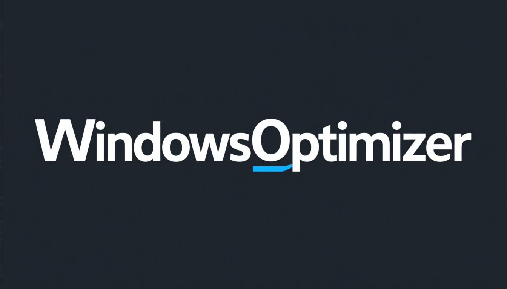

<div align="center">



# WindowsOptimizer

**A free, open-source Windows optimization tool focused on performance, privacy, and simplicity — delivered as a single, menu-driven PowerShell app. No install, no GUI, no telemetry.**

[](https://github.com/demo7up/WindowsOptimizer/releases/latest)
[](https://github.com/demo7up/WindowsOptimizer/stargazers)
[](./LICENSE)
<br>
[](https://learn.microsoft.com/powershell/)
[](https://www.microsoft.com/software-download/)
[](#safety)

</div>

```text
__        ___           _
\ \      / (_)_ __   __| | _____      _____
 \ \ /\ / /| | '_ \ / _` |/ _ \ \ /\ / / __|
  \ V  V / | | | | | (_| | (_) \ V  V /\__ \
   \_/\_/  |_|_| |_|\__,_|\___/ \_/\_/ |___/
  ___        _   _           _
 / _ \ _ __ | |_(_)_ __ ___ (_)_______ ___
| | | | '_ \| __| | '_ ` _ \| |_  / _ \ '__|
| |_| | |_) | |_| | | | | | | |/ /  __/ |
 \___/| .__/ \__|_|_| |_| |_|_/___\___|_|
      |_|   PowerShell Edition   By: Firemax

  Mode: DRY-RUN (no changes written)
  --------------------------------------------------------------
   1. Privacy & Telemetry            (30)
   2. Performance                    (8)
   3. Gaming                         (7)
   4. GPU Tuning                     (8)
   5. Power                          (10)
   6. Appearance & Personalization   (34)
   7. Apps & Bloatware               (18)
   8. Network                        (15)
   9. System Repair                  (33)
  10. Cleanup & Storage              (19)
  11. Diagnostics & Reports          (20)
  12. Services & Startup             (6)
  13. Security & Firewall            (7)
  14. Windows Features & Updates     (15)
  15. Files & Folders                (8)
  16. Launchers                      (29)
  == MORE ==
  17. Search / All features
  18. Revert
  19. Switch to LIVE mode
   0. Exit
```

---

## Quick Start

### Run it in one line (no download)

Open **PowerShell** and paste:

```powershell
irm https://raw.githubusercontent.com/demo7up/WindowsOptimizer/main/boot.ps1 | iex
```

This downloads the latest version to a temp folder and launches it. The app **elevates itself** (accept the UAC prompt) and opens in **DRY-RUN** mode, so you can explore every menu without changing anything. Switch to **LIVE** from the **MORE** section when you're ready to apply real changes.

### Or download and run

1. Download the repo (green **Code** > **Download ZIP**, or `git clone`), and extract it anywhere.
2. Right-click `WindowsOptimizer.ps1` > **Run with PowerShell**, or from a prompt:
   ```powershell
   powershell -ExecutionPolicy Bypass -File .\WindowsOptimizer.ps1
   ```

> [!TIP]
> Create a **system restore point** before applying changes. Everything here is reversible, but a restore point is a good safety net.

> [!NOTE]
> It runs on **Windows PowerShell 5.1** (built into Windows 10/11) or **PowerShell 7+**. No .NET SDK, no build step, no dependencies.

---

## What It Does & Why It Matters

Windows works great out of the box. But a fresh installation also ships background services, telemetry, pre-installed apps, and scheduled tasks that keep running even if you never use them. At the same time, many settings that improve performance, reduce latency, or make the system feel smoother are off by default.

WindowsOptimizer brings it all into **16 categories** - optimize, customize, repair, clean, diagnose, and manage Windows from one menu-driven app, without digging through the Registry, Group Policy, or hand-written scripts. Every tweak is reversible, each is risk-rated, and **nothing is applied until you select it.**

## Categories

All **267 features** are organized into these 16 categories:

| Category | Items | What's inside |
| :--- | ---: | :--- |
| **Privacy & Telemetry** | 30 | Telemetry, advertising ID, Cortana, Copilot, Recall, location, activity history, suggestions, and history clears. |
| **Performance** | 8 | Background apps, service-host grouping, process priority, multimedia scheduler, keyboard latency, SysMain. |
| **Gaming** | 7 | Game Mode, Game Bar, GameDVR, fullscreen optimizations, HAGS, DLSS indicator, mouse acceleration. |
| **GPU Tuning** | 8 | Vendor power-state and latency tweaks for AMD, NVIDIA and Intel. |
| **Power** | 10 | Hibernation, Fast Startup, USB power, power plans, throttling, scheduled shutdown. |
| **Appearance & Personalization** | 34 | Dark mode, visual effects, desktop icons, taskbar and Explorer options, context menu, and more. |
| **Apps & Bloatware** | 18 | Remove AppX/bloatware, winget, OneDrive/Office/Outlook repair, browser caches, Store app repair. |
| **Network** | 15 | DNS, TCP/IP, Winsock, adapters, ping/traceroute/port checks, Wi-Fi passwords. |
| **System Repair** | 33 | Deep/Quick Fix, DISM, SFC, chkdsk, and resets for Update, WMI, Search, GPO, Hello and more. |
| **Cleanup & Storage** | 19 | Temp and cache clears, Recycle Bin, Windows.old, restore points, defrag, disk health, large files. |
| **Diagnostics & Reports** | 20 | Specs, logs, drivers, dxdiag, Defender scan, and system/crash reports. |
| **Services & Startup** | 6 | Service startup baseline, restart services, startup manager, scheduled tasks. |
| **Security & Firewall** | 7 | Firewall, Defender, Smart App Control, credentials, Windows Hello, BitLocker. |
| **Windows Features & Updates** | 15 | Hyper-V, DirectPlay, Telnet, Dev Mode, long paths, and update controls. |
| **Files & Folders** | 8 | Permissions, ownership, force delete, hide/lock. |
| **Launchers** | 29 | Quick access to Device Manager, Registry, Event Viewer and other Windows consoles. |

> [!NOTE]
> Items are tagged by type: a one-shot `run` or `info` task, an `open` (launches a Windows tool), or a reversible `tweak`, `setting`, or `toggle`. Destructive tasks require typing `ARM` to confirm.

## Full Feature List

Every feature in one place. Click a category to expand.

<details>
<summary><b>Privacy & Telemetry (30)</b></summary>

- Disable Telemetry `[tweak]` - Reduce core Windows telemetry, feedback, app-compat inventory and diagnostic services/tasks.
- Disable Error Reporting `[tweak]` - Disable Windows Error Reporting and the Program Compatibility Assistant.
- Disable Advertising & Suggestions `[tweak]` - Disable advertising ID, consumer features, tailored experiences and system suggestions.
- Disable News & Interests `[tweak]` - Disable the News and Interests taskbar feed.
- Hide Meet Now Button `[tweak]` - Hide the Meet Now button from the taskbar.
- Disable Activity History `[tweak]` - Disable activity history collection and syncing to the cloud.
- Disable Location & Sensors `[tweak]` - Disable location tracking, sensors, geolocation service, WiFi Sense and offline maps auto-updates.
- Disable AutoLogger ETW Sessions `[tweak]` - Disable WMI AutoLogger ETW trace sessions.
- Disable Cortana & Web Search `[tweak]` - Disable Cortana, cloud search and connected web search.
- Disable Copilot `[tweak]` - Disable Windows Copilot via policy, hide the taskbar button, block its shell extension.
- Disable Content Delivery Manager `[tweak]` - Disable the Content Delivery Manager and its subscribed-content/suggestion feeds.
- Disable Find My Device `[tweak]` - Disable Find My Device location tracking.
- Disable Delivery Optimization `[tweak]` - Disable peer-to-peer Delivery Optimization download sharing.
- Disable Start Menu Web Search `[tweak]` - Disable web search suggestions in the Start Menu.
- Disable Microsoft 365 Ads in Settings `[tweak]` - Disable Microsoft 365 ads shown in Settings.
- Disable Recall `[tweak]` - Disable Windows Recall AI snapshots.
- Disable Click To Do `[tweak]` - Disable the Click To Do AI overlay (Windows 11 24H2+).
- Explorer Sync Notifications `[setting]` - OneDrive / sync-provider promotional notifications shown inside File Explorer.
- System Suggestions `[setting]` - Windows tips, tricks and suggestions shown in Settings and Start.
- Bing / Web Search `[setting]` - Bing web results and suggestions in Start menu / taskbar search.
- Address Bar History `[run]` - Clear Explorer's typed-paths history.
- Recent Items `[run]` - Clear the Recent Items list.
- Run History `[run]` - Clear the Run dialog (RunMRU) history.
- Telemetry `[toggle]` - Windows diagnostic data collection (DiagTrack).
- Personalized Ads `[toggle]` - Advertising ID used for personalized ads.
- File Explorer Ads `[toggle]` - Sync-provider promotional ads in File Explorer.
- Lock Screen Ads `[toggle]` - Spotlight / promotional content on the lock screen.
- Taskbar Tips & Ads `[toggle]` - Suggestions and tips shown near the taskbar.
- Start Menu Suggestions `[toggle]` - Suggested apps and content in the Start menu.
- Location Services `[toggle]` - System-wide location access.

</details>

<details>
<summary><b>Performance (8)</b></summary>

- Disable Background Apps `[tweak]` - Disable background apps globally.
- Consolidate Service Hosts `[tweak]` - Raise the svchost split threshold to total RAM so services share fewer host processes.
- Process Priority (Foreground Boost) `[tweak]` - Enable foreground boost (Win32PrioritySeparation = 38).
- Optimize Multimedia Scheduler `[tweak]` - Tune MMCSS for gaming / low latency.
- Keyboard Latency Optimization `[tweak]` - Minimize keyboard repeat delay and maximize repeat speed.
- Disable Accessibility Keyboard Hotkeys `[tweak]` - Disable StickyKeys / FilterKeys / ToggleKeys hotkeys.
- Lift WebDAV File Size Limit `[tweak]` - Lift the WebDAV file size limit to ~4 GB.
- SysMain (SuperFetch) `[toggle]` - SysMain preloading service.

</details>

<details>
<summary><b>Gaming (7)</b></summary>

- Game Mode `[setting]` - Windows Game Mode: prioritises the foreground game and pauses some background work.
- Xbox Game Bar `[setting]` - The Xbox Game Bar overlay opened with Win+G (capture, performance, widgets).
- Background Recording (GameDVR) `[setting]` - GameDVR background recording. Turning it off frees resources and can reduce stutter.
- Mouse Acceleration `[setting]` - Pointer precision (mouse acceleration). Off gives 1:1 movement, preferred for gaming/aim.
- Fullscreen Optimizations `[setting]` - Windows fullscreen optimizations (hybrid borderless fullscreen). Off forces true exclusive fullscreen.
- Hardware-Accelerated GPU Scheduling `[setting]` - HAGS: lets the GPU manage its own memory scheduling. May reduce latency on supported GPUs.
- DLSS Indicator `[setting]` - The NVIDIA DLSS on-screen overlay indicator (shows when DLSS is active).

</details>

<details>
<summary><b>GPU Tuning (8)</b></summary>

- AMD: Disable ULPS `[tweak]` - Disable AMD Ultra Low Power State.
- AMD: Disable Power Gating `[tweak]` - Disable AMD GPU power gating / dynamic P-state.
- AMD: Disable Video Clock Gating `[tweak]` - Disable AMD video (VCE/UVD) power and clock gating.
- AMD: Disable ASPM `[tweak]` - Disable AMD PCIe ASPM (L0s/L1) link power management.
- NVIDIA: Disable Dynamic P-State `[tweak]` - Disable NVIDIA dynamic P-state.
- NVIDIA: Disable Async P-States `[tweak]` - Disable NVIDIA asynchronous P-states.
- Intel: Disable Async Flips `[tweak]` - Disable Intel display async flips.
- Intel: Disable Adaptive V-Sync `[tweak]` - Disable Intel adaptive V-Sync.

</details>

<details>
<summary><b>Power (10)</b></summary>

- Disable Hibernation & Fast Startup `[tweak]` - Disable hibernation and Fast Startup (removes hiberfil.sys).
- Disable USB Power Saving `[tweak]` - Disable USB selective suspend / power saving on all USB devices.
- Install High-Performance Power Plan `[tweak]` - Import and activate the bundled high-performance power plan.
- Disable Power Saving `[tweak]` - Disable USB power-drain recovery and CPU power throttling.
- Hibernate `[toggle]` - System hibernation support.
- Fast Startup `[toggle]` - Hybrid shutdown ? disable to fix wake/shutdown/dual-boot issues.
- Ultimate Performance `[run]` - Add the Ultimate Performance power plan.
- Restore Power Plans `[run]` - Restore the default power schemes.
- Schedule Shutdown `[run]` - Shut down after a number of minutes.
- Cancel Shutdown `[run]` - Abort a scheduled shutdown.

</details>

<details>
<summary><b>Appearance & Personalization (34)</b></summary>

- Speed Up Explorer & Menus `[tweak]` - Speed up Explorer startup and remove the menu show delay.
- Disable Visual Effects `[tweak]` - Disable taskbar animations, listview shadows, transparency and Aero Peek.
- Hide Start Recommended Section `[tweak]` - Hide the Recommended section in the Start Menu (Windows 11).
- Show This PC Icon `[setting]` - Show or hide the This PC icon on the desktop.
- Show Recycle Bin Icon `[setting]` - Show or hide the Recycle Bin icon on the desktop.
- Show User Files Icon `[setting]` - Show or hide your user profile folder icon on the desktop.
- Show Network Icon `[setting]` - Show or hide the Network icon on the desktop.
- Show Control Panel Icon `[setting]` - Show or hide the Control Panel icon on the desktop.
- Show Desktop Icons (master) `[setting]` - Master toggle to show or hide ALL desktop icons at once.
- Shortcut Overlay Arrow `[setting]` - Show or hide the small arrow overlay drawn on shortcut icons.
- Taskbar Alignment `[setting]` - Align taskbar icons to the center (default) or the left (Windows 11).
- Combine Taskbar Buttons `[setting]` - When taskbar buttons of the same app group together: always, only when the bar is full, or never.
- Taskbar Widgets `[setting]` - The Widgets (weather/news) button on the taskbar (Windows 11).
- Task View Button `[setting]` - The Task View (virtual desktops) button on the taskbar.
- Taskbar End Task `[setting]` - Add an "End Task" option to the taskbar right-click menu (Windows 11).
- Dark Mode `[setting]` - Switch Windows apps and the system UI between dark and light themes.
- Toast Notifications `[setting]` - Pop-up (toast) notifications from apps and Windows.
- Explorer Compact Mode `[setting]` - Tighter row spacing in File Explorer (Windows 11 compact view).
- Snap Assist Flyout `[setting]` - The Snap layouts flyout that appears when you hover/maximize a window (Windows 11).
- Explorer Item Checkboxes `[setting]` - Selection check boxes shown on items in File Explorer.
- Show File Extensions `[setting]` - Show known file name extensions (e.g. .txt, .exe) in File Explorer.
- Show Hidden Files `[setting]` - Show hidden files and folders in File Explorer.
- Clipboard History `[setting]` - Windows clipboard history (Win+V) that stores multiple copied items.
- Window Shake (Aero Shake) `[setting]` - Aero Shake: shaking a window title bar minimizes all other windows.
- Show Seconds in System Clock `[setting]` - Show seconds on the taskbar clock (uses slightly more power/CPU).
- Explorer Launch Target `[setting]` - What File Explorer opens to when launched: This PC or Quick Access.
- Classic Context Menu `[setting]` - Use the Windows 10 classic right-click menu instead of the trimmed Windows 11 one.
- Taskbar Search Box `[setting]` - How the taskbar search appears: hidden, icon only, icon + label, or a full search box.
- Taskbar Last Active Click `[setting]` - Clicking a grouped taskbar button jumps straight to the last active window of that app.
- Num Lock on Boot `[setting]` - Turn Num Lock on automatically at startup and the sign-in screen.
- Verbose Boot Status `[setting]` - Show detailed status messages during startup and shutdown (useful for diagnosing hangs).
- Show Battery Percentage `[setting]` - Show the battery percentage next to the taskbar battery icon (Windows 11).
- Classic Context Menu `[toggle]` - Restore the full Win10-style right-click menu.
- PrtScn ? Snipping `[toggle]` - Use the Print Screen key to open Snipping Tool.

</details>

<details>
<summary><b>Apps & Bloatware (18)</b></summary>

- Block Preinstalled Apps `[tweak]` - Block preinstalled / OEM / silent apps via ContentDeliveryManager.
- Fix Windows Apps `[run]` - Re-register Store, Start Menu and built-in packages.
- Repair Start Menu `[run]` - Re-register the Start Menu and Shell Experience packages.
- Default Apps Settings `[open]` - Open Default Apps to reset file associations.
- Repair a Store App `[run]` - Re-register a specific UWP/Store app by name (e.g. Photos, Calculator).
- Upgrade All Programs `[run]` - Update every app via winget.
- Pin to Taskbar `[run]` - Pin an executable to the taskbar (best effort).
- Unpin from Taskbar `[run]` - Unpin an executable from the taskbar (best effort).
- Reset OneDrive `[run]` - Reset OneDrive to fix stuck or failed sync.
- Office Quick Repair `[run]` - Run Microsoft Office Click-to-Run Quick Repair.
- Repair Outlook `[run]` - Launch Outlook with a reset navigation pane (fixes a broken profile view).
- Reset Winget Sources `[run]` - Reset winget package sources (fixes winget errors).
- Clear Browser Caches `[run]` - Clear Chrome / Edge / Brave / Firefox caches (close browsers first).
- Debloat (Recommended) `[run]` - Apply the recommended privacy/debloat set: telemetry, ads, suggestions, and lock-screen spotlight off.
- Remove Common Bloatware `[run]` - Uninstall common preinstalled apps (Candy Crush, Xbox, News, Weather, Clipchamp, etc.).
- List Installed Apps `[info]` - List all installed UWP/Store apps (for targeted removal).
- Uninstall a Program `[run]` - Silently uninstall a program by name via winget.
- Bloatware Remover `[tool]` - List and remove installed Store (AppX) apps.

</details>

<details>
<summary><b>Network (15)</b></summary>

- Disable Smart Name Resolution `[setting]` - Stop Windows sending DNS queries to all interfaces at once (privacy / DNS-leak hardening).
- Cycle Network Adapters `[run]` - Disable then re-enable active network adapters (briefly drops connectivity).
- Flush DNS `[run]` - Clear the DNS resolver cache.
- Release / Renew IP `[run]` - Release and renew the DHCP lease.
- Reset TCP/IP `[run]` - Reset the TCP/IP stack to defaults.
- Winsock Reset `[run]` - Rebuild the Winsock catalog.
- Reset Network `[run]` - Full reset: Winsock, TCP/IP, firewall, DNS and DHCP.
- IP Configuration `[info]` - Show full IP configuration (ipconfig /all).
- Test Connection `[info]` - Ping a host to test connectivity.
- Set Network to Private `[run]` - Set active networks to Private (enables discovery and file/printer sharing).
- Active Connections `[info]` - Established TCP connections and owning processes.
- Traceroute `[info]` - Trace the route to a host.
- DNS Lookup `[info]` - Resolve a hostname.
- Port Check `[info]` - Test whether a TCP port is open on a host.
- Wi-Fi Passwords `[info]` - Show saved Wi-Fi network names and passwords.

</details>

<details>
<summary><b>System Repair (33)</b></summary>

- Deep Fix `[run]` - Full guided sequence: clear temp ? flush DNS ? DISM RestoreHealth ? SFC ? component cleanup.
- Quick Fix `[run]` - Lighter pass: clear temp, flush DNS, restart Explorer.
- DISM RestoreHealth `[run]` - Repair the Windows component store online.
- Run SFC `[run]` - Scan and repair protected system files.
- Check Disk `[run]` - Online scan of the C: volume for errors.
- Reset Secure Channel `[run]` - Repair the machine's domain secure channel.
- Update Group Policy `[run]` - Force a Group Policy refresh (gpupdate /force).
- Self-Healing Mode `[run]` - Run a full component health scan and enable automatic maintenance.
- Reset Core Settings `[run]` - Reset Winsock, TCP/IP, firewall and Windows Update components to defaults.
- Rebuild WMI Repository `[run]` - Verify and salvage the WMI repository (fixes corruption that breaks updates, Defender, reports).
- Reset Windows Search `[run]` - Rebuild the Windows Search index (fixes Start-menu search returning nothing).
- Clear Print Queue `[run]` - Stop the spooler, delete stuck print jobs, and restart it.
- Force Time Resync `[run]` - Fix a wrong clock (causes cert/HTTPS/login failures) by resyncing to time.windows.com.
- Rebuild Icon Cache `[run]` - Fix corrupted/blank icons by clearing the icon cache and restarting Explorer.
- Reset Local Group Policy `[run]` - Remove local Group Policy (registry.pol) and refresh ? fixes GPO corruption.
- Reset Hosts File `[run]` - Restore the hosts file to default (backs up the old one as hosts.bak).
- Rebuild Performance Counters `[run]` - Fix broken Task Manager / perfmon / monitoring graphs.
- Enable .NET 3.5 `[run]` - Enable the .NET Framework 3.5 feature for legacy apps (needs internet or media).
- Reset Notifications `[run]` - Reset the Action Center / notification database.
- Clear Error Reports `[run]` - Clear the Windows Error Reporting queue and archive.
- Fix Audio / Sound `[run]` - Restart the Windows Audio services.
- Fix Bluetooth `[run]` - Restart the Bluetooth support service.
- Fix Hardware Detection `[run]` - Rescan for new / disconnected hardware.
- Audio Troubleshooter `[open]` - Windows audio playback troubleshooter.
- Bluetooth Troubleshooter `[open]` - Open the Bluetooth troubleshooter.
- Restart BITS `[run]` - Restart the Background Intelligent Transfer Service (fixes stuck updates).
- Camera Troubleshooter `[open]` - Open the camera troubleshooter.
- Network Troubleshooter `[open]` - Network adapter troubleshooter.
- Printer Troubleshooter `[open]` - Diagnose printing problems.
- Program Compatibility `[open]` - Program compatibility troubleshooter.
- Video Playback `[open]` - Video playback troubleshooter.
- Media Player `[open]` - Windows Media Player settings troubleshooter.
- Windows Update `[open]` - Windows Update troubleshooter.

</details>

<details>
<summary><b>Cleanup & Storage (19)</b></summary>

- Reclaim Disk Space (deep) `[run]` - Component store cleanup + ResetBase ? shrinks WinSxS (updates can no longer be uninstalled).
- Clear User Temp `[run]` - Delete the current user's temp files.
- Clear Windows Temp `[run]` - Delete the system-wide Windows temp files.
- Clear Update Cache `[run]` - Stop services and clear the Windows Update download cache.
- Clear Store Cache `[open]` - Reset the Microsoft Store cache (wsreset).
- Clear Teams Cache `[run]` - Close Teams and clear its cache.
- Clear Outlook Cache `[run]` - Clear the Outlook roaming cache.
- Clear Thumbnails `[run]` - Rebuild the Explorer thumbnail cache.
- Empty Recycle Bin `[run]` - Permanently empty the Recycle Bin.
- Disk Cleanup `[open]` - Open the Windows Disk Cleanup tool.
- Temp Internet Files `[run]` - Clear cached internet files.
- Delete Windows.old `[run]` - Remove the previous Windows installation folder.
- Delete Restore Points `[run]` - Delete all system restore points and shadow copies.
- Wipe Free Space `[run]` - Securely overwrite free space on C: (can take a while).
- Defragment C: `[run]` - Optimize / defragment the C: volume.
- Disk Health (SMART) `[info]` - Physical disk health and status.
- Top Space Users `[info]` - Largest top-level folders on C: (may take a moment).
- Find Large Files `[info]` - Largest 25 files under a folder.
- Disk Cleanup `[tool]` - Clear temp, Windows temp, Update cache, prefetch and the Recycle Bin.

</details>

<details>
<summary><b>Diagnostics & Reports (20)</b></summary>

- Check Specifications `[info]` - Summary of CPU, RAM, GPU and OS.
- System Summary `[info]` - Detailed computer info (Get-ComputerInfo).
- System Information `[open]` - Open msinfo32.
- GPU Information `[info]` - Graphics adapter details.
- User Information `[info]` - Local users and current group membership.
- Installed Drivers `[info]` - List signed device drivers.
- Installed Programs `[info]` - List installed applications.
- Pinned Programs `[info]` - List taskbar-pinned programs.
- Battery Report `[run]` - Generate and open a battery health report.
- System Event Logs `[info]` - Recent System event-log entries.
- Application Logs `[info]` - Recent Application event-log entries.
- Security Logs `[info]` - Recent Security event-log entries.
- DirectX Diagnostic `[open]` - Open dxdiag.
- Memory Diagnostic `[open]` - Schedule the Windows Memory Diagnostic (reboots).
- Defender Quick Scan `[run]` - Run a Microsoft Defender quick scan.
- Backup Drivers `[run]` - Export all third-party drivers to a Desktop folder.
- System Report `[run]` - Generate a branded HTML system report (specs, OS, disks, GPU) and open it.
- Client Report (PDF) `[run]` - Generate a branded, client-ready PDF system report (via Edge) and open it.
- Crash / BSOD Report `[info]` - Recent critical/error events and minidumps.
- System Dashboard `[tool]` - CPU, RAM, GPU, storage, uptime and active power plan at a glance.

</details>

<details>
<summary><b>Services & Startup (6)</b></summary>

- Configure Services (batch) `[tweak]` - Reconfigure the startup type of 239 Windows services to a tuned baseline. RISKY - reverts individually.
- Restart Explorer `[run]` - Restart the Windows shell (explorer.exe).
- Restart Print Spooler `[run]` - Restart the print spooler service.
- Restart into BIOS `[run]` - Reboot directly into UEFI firmware settings.
- Startup Manager `[tool]` - See and toggle Run-key startup entries.
- Scheduled Task Manager `[tool]` - Browse, enable and disable Windows scheduled tasks.

</details>

<details>
<summary><b>Security & Firewall (7)</b></summary>

- Clear Credential Manager `[run]` - Purge stored Windows credentials (fixes stale creds / repeated auth prompts).
- Reset Windows Hello (PIN) `[run]` - Clear the Ngc store so the PIN / Hello can be re-enrolled (fixes broken PIN sign-in).
- Smart App Control `[toggle]` - Set SAC policy state (requires restart).
- Check Smart App Control `[info]` - Report the current Smart App Control state.
- Firewall On `[run]` - Enable Windows Firewall on all profiles.
- Firewall Off `[run]` - Disable Windows Firewall on all profiles.
- Reset Firewall `[run]` - Reset Windows Firewall to its default rules and settings.

</details>

<details>
<summary><b>Windows Features & Updates (15)</b></summary>

- Maximize Update Pause Limit `[tweak]` - Maximize the Windows Update pause limit.
- UTC Hardware Clock `[setting]` - Treat the hardware (BIOS) clock as UTC. Helps when dual-booting with Linux.
- Developer Mode `[setting]` - Windows Developer Mode: sideload apps and run unsigned packages without a dev license.
- Allow All Trusted Apps `[setting]` - Allow installing all trusted (sideloaded) app packages.
- Long Paths (>260 chars) `[setting]` - Enable Win32 long-path support so paths longer than 260 characters work.
- Check for Updates `[run]` - Trigger a Windows Update scan.
- Full Windows Update Reset `[run]` - Stop services, clear SoftwareDistribution + catroot2, re-register WU components, reset Winsock.
- Hyper-V `[toggle]` - The Hyper-V virtualization platform (needs restart).
- DirectPlay `[toggle]` - Legacy DirectPlay component for old games.
- Telnet Client `[toggle]` - The command-line Telnet client.
- Quick Machine Recovery `[open]` - Open recovery settings (Quick Machine Recovery).
- God Mode `[run]` - Create the 'All Tasks' (God Mode) shortcut on the Desktop.
- Update History `[info]` - Recently installed updates/hotfixes.
- Pause Updates 7 Days `[run]` - Pause Windows Update for one week.
- Resume Updates `[run]` - Remove the Windows Update pause.

</details>

<details>
<summary><b>Files & Folders (8)</b></summary>

- Repair Permissions `[run]` - Take ownership and reset NTFS permissions on a path.
- Take Ownership `[run]` - Take full ownership and grant Administrators control.
- Force Delete `[run]` - Take ownership then force-delete a stubborn item.
- Restore Hidden Files `[run]` - Clear hidden/system/read-only attributes across a drive (post-malware).
- Hide Item `[run]` - Set the hidden attribute on a path.
- Unhide Item `[run]` - Remove the hidden attribute from a path.
- Lock Item `[run]` - Deny Everyone access to a path.
- Unlock Item `[run]` - Reset permissions to unlock a path.

</details>

<details>
<summary><b>Launchers (29)</b></summary>

- Task Manager `[open]` - Open Task Manager.
- Device Manager `[open]` - Open Device Manager.
- Disk Management `[open]` - Open Disk Management.
- Diskpart `[open]` - Open the diskpart console.
- Computer Management `[open]` - Open Computer Management.
- Services `[open]` - Open the Services manager.
- Event Viewer `[open]` - Open Event Viewer.
- Registry Editor `[open]` - Open the Registry Editor.
- Group Policy `[open]` - Open the Local Group Policy Editor.
- System Config `[open]` - Open msconfig.
- Task Scheduler `[open]` - Open Task Scheduler.
- Performance Monitor `[open]` - Open Performance Monitor.
- Resource Monitor `[open]` - Open Resource Monitor.
- Reliability Monitor `[open]` - Open Reliability Monitor.
- Command Prompt `[open]` - Open a Command Prompt.
- PowerShell `[open]` - Open a PowerShell console.
- Uninstaller `[open]` - Open Programs & Features.
- BitLocker `[open]` - Open BitLocker management.
- System Restore `[open]` - Open System Restore.
- User Accounts `[open]` - Open advanced User Accounts.
- Windows Security `[open]` - Open Windows Security.
- Windows Update `[open]` - Open Windows Update.
- Activation `[open]` - Open Windows Activation.
- Microsoft Store `[open]` - Open the Microsoft Store.
- Remote Desktop `[open]` - Open Remote Desktop Connection.
- Open MyTools Folder `[tool]` - Open the folder where generated scripts are saved.
- One-Click Maintenance `[tool]` - Generate a ready-to-run maintenance .ps1 into MyTools.
- Unlock MyTools `[tool]` - Reset permissions on the MyTools folder.
- Schedule Weekly Maintenance `[tool]` - Create a weekly scheduled task: clear temp + flush DNS.

</details>

---

## Safety

Changing system settings carries risk. WindowsOptimizer is built around **reversibility and user control**.

- **Dry-run by default** — the app starts in DRY-RUN; nothing is written until you deliberately switch to LIVE.
- **Automatic backups** — before each change, the prior value is snapshotted to `%LocalAppData%\WindowsOptimizer\Revert\{id}.json`. Restore individual tweaks or roll back everything.
- **One-step revert** — undo any applied optimization or setting from the Revert menu.
- **Risk ratings** — each tweak is labeled Safe, Moderate, or Risky.
- **Arm-to-run** — destructive tasks require typing `ARM` before they run.
- **No defaults applied** — nothing runs until you select it.

---

## FAQ

### Is it safe to use?

Yes. It is fully **open-source (GPL v3)** — every line is plain PowerShell you can read before running. There is no compiled binary and no build step; what you see is what runs. It collects **zero telemetry** and works entirely offline.

### Does it actually improve performance?

It can help. Every optimization targets a real setting that Windows configures conservatively by default (service-host grouping, GPU power states, network throttling, process scheduling, background telemetry). It won't double your FPS, but it reduces background activity, lowers latency, and makes the system feel more responsive.

### Can I undo changes?

Yes. Every optimization and setting writes a revert snapshot of the exact prior state before changing anything, so revert restores precisely what was there — not a guessed default. Repair and maintenance tasks (DISM, SFC, cleanups, etc.) are one-shot actions and are clearly flagged; create a restore point before running destructive ones.

### Does it run on Windows 10 and 11?

Yes — **Windows 10/11 (x64 & ARM64)**, on Windows PowerShell 5.1 or PowerShell 7+.

### Do I need administrator rights?

Yes. It modifies system settings and the registry, so it elevates itself on launch.

### Why does PowerShell block the script?

Windows restricts script execution by default. Launch it with `-ExecutionPolicy Bypass` as shown in Quick Start — this applies only to that one run and changes nothing permanently.

---

## Technical Details

- **Pure PowerShell** — Windows PowerShell 5.1 compatible; no .NET SDK, no compilation.
- **Declarative data model** — every optimization, setting, and toolbox task is defined as data (`data/*.psd1`); the engine dispatches each operation to the right primitive.
- **Revert system** — registry, service, scheduled-task, hibernation, USB-power, and power-plan changes each capture their prior state to JSON for precise rollback.
- **Self-elevating** — relaunches elevated automatically; defaults to a safe dry-run.
- **ASCII-clean & logged** — every session is logged to `%LocalAppData%\WindowsOptimizer\Logs`.

### Project layout

| Area | Files |
| :--- | :--- |
| Entry point + main menu | `WindowsOptimizer.ps1` |
| Primitives (registry/service/task/power/revert) | `modules/OD{Registry,Service,SchedTask,Power,Revert}.psm1` |
| Conditions, engine, data loader | `modules/OD{Conditions,Engine,Data}.psm1` |
| Menus, tools, tasks | `modules/OD{Menu,Tools,Toolbox}.psm1` |
| Definitions (declarative) | `data/{optimizations,customize,services,toolbox}.psd1` |
| Bundled assets | `data/highperf-powerplan.pow`, `data/blank.ico` |

---

## Disclaimer

WindowsOptimizer is provided **"as is"**, without warranty of any kind. By using it, you agree the authors are not liable for system instability, data loss, or issues caused by third-party software or user modifications. It modifies system settings and the Windows registry — **use at your own risk**, and create a restore point before applying changes.

---

## License

<div align="center">

**[GPL v3 License](https://www.gnu.org/licenses/gpl-3.0.en.html)** — see [LICENSE](./LICENSE).

[Back to top](#windowsoptimizer)

</div>
